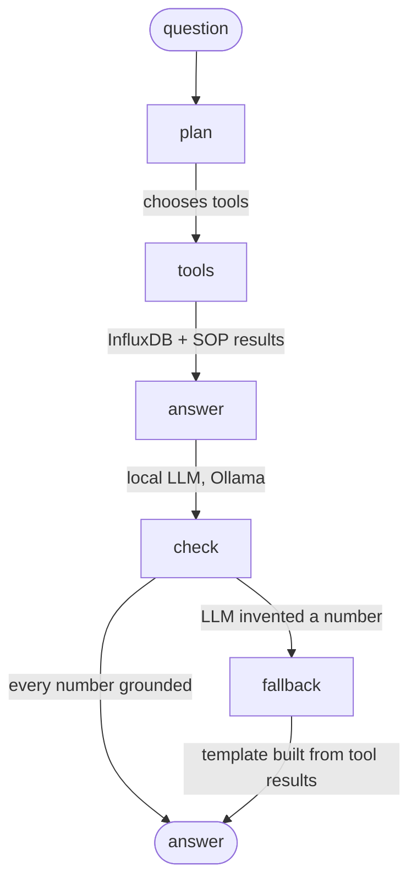

# Ask VialGuard, LangGraph edition

A LangGraph agent that answers questions from the live InfluxDB data (see `pipeline/`).
Follows the classic agent pattern (question → agent → tools → answer) and adds a guardrail step.



| Tool | What it does |
|---|---|
| `query_telemetry_db` | Flux query on InfluxDB: latest reading, summary, or excursions outside 2–8 °C |
| `get_forecast` | Latest XGBoost and LSTM 10-minute forecasts stored by the stream processor |
| `audit_hash_chain` | Counts readings whose SHA-256 chain link failed verification |
| `search_compliance_sop` | Sourced WHO / USP rules (small fixed corpus, cited) |

## Measured, not assumed (`python agent/eval_planner.py`)

Who picks the right tools? A plan is correct only if it calls exactly the needed tools.

| Planner | Tuning set (12) | Held-out (8, written afterwards, nothing changed after) | Time |
|---|---|---|---|
| Keyword router | 12/12 (after fixing 2 bugs on this set) | **7/8** | instant |
| qwen2.5-coder 1.5B via Ollama | 7/12 | 2/8 | 3.5 s |

So the router chooses tools and the LLM only writes the answer. The `check` node then rejects any number that is
not in a tool result: in testing, the 1.5B model invented a 7-step "procedure", the check caught it, and the
fallback answered from the data instead. A larger local model can be plugged in with `VG_OLLAMA_MODEL`
and `--llm-plan`, and re-measured with the same script.

## Run

```
pipeline\start_pipeline.bat              # Kafka + InfluxDB + stream processor
python pipeline\producer.py --real       # stream the real data
python agent\vialguard_graph.py "Did fridge BLD26-001 ever go above 8 °C?"
python agent\vialguard_graph.py --no-llm "..."     # no Ollama needed
python -m unittest agent/test_graph.py
```

Packages: `pip install --target D:/vialguard-agent langgraph langchain-ollama` (kept on D: because C: is small).
Ollama with `qwen2.5-coder:1.5b` (or any tool-capable model) for LLM answers.

The browser version (`dashboard/agent.js`) is the same tool-calling pattern without a server, so the public site
works offline.
